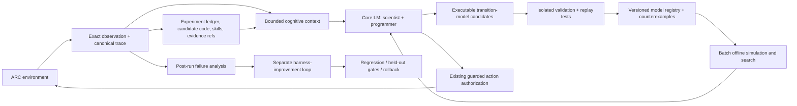

# AREx V2 — Coding Agent Handoff

> **Status:** Proposed V2 architecture; implementation has **not** begun.
> **Updated:** 2026-10-14
> **Repository:** https://github.com/SiddarthaKoppaka/AREx
> **For:** The next coding agent, the reviewer, and future AREx research sessions.
> **Companion:** `AREx_V2_Architecture_Roadmap.md` (research/design rationale). This document is the *operational handoff*.

## 0. Mission and immediate instruction

Build **AREx V2: Executable Epistemic Evolution** as a sequence of small, measurable, independently reviewable changes. **Do not rewrite the whole harness.**

> **The LM is the scientist and programmer. The harness is the laboratory, memory, deterministic computation, guarded executor, and experimental record.**

The model owns interpretation, competing hypotheses, experimentation, world-model proposals, goals, strategy, and legal action selection. The harness supplies deterministic tools and evidence but never silently substitutes a hidden policy for the model's decision.

**FIRST TASK FOR THE CODING AGENT: PR-00 only — establish a reproducible V1 baseline and expose existing failures as trace-derived metrics.** Do not implement other PRs until explicitly assigned.

**System-level success:** improve *correct environmental knowledge learned and reused per real game action* and *ARC-AGI-3 performance per token/compute budget*. Tool-call count, prompt length, number of specialists, and code volume are not success measures on their own.

## 1. Problem statement

Research runs have shown or suggested:

1. **Tool underuse:** the LM may not choose available search, simulation, exploration, and world-model operations when they are useful.
2. **Under-experimentation:** too few genuinely discriminating probes; the model reasons repeatedly without testing important uncertainty.
3. **Over-reasoning:** many model calls and tokens can pass without changes in observation, belief, or progress.
4. **Limited world-model iteration:** actual transition evidence is not consistently converted into revised and validated models.
5. **Redundant tool/action use:** equivalent interventions or cognitive-tool queries are repeated under materially unchanged conditions.
6. **Fragile context continuity:** canonical history exists, but bounded prompt projection and limited retrieval can fail to bring the right old lesson back to the next decision.
7. **Context-size failures:** optional sections and retrieved artifacts may still cause pressure against effective generation limits.

These are **failure hypotheses until measured from real stored traces**, not license to invent metrics. In particular, never hardcode previously discussed run numbers without an accessible, verifiable trace.

## 2. Existing V1 — preserve and build on it

The repository already has:

| Mechanism | Current entry points |
|---|---|
| Core prompt and tool JSON contracts | `src/arc_agi_3/adapters/prompts.py`, `prompt_text.py`, `tool_schemas.py`, `tool_registry.py` |
| Fresh reconstructed decision prompt per call | `adapters/transformers.py`, `runtime/context.py` |
| Typed decisions, including hypotheses, plans, tools, world models, actions | `contracts/decision_core.py`, `contracts/decision.py` |
| Cognitive session and guarded action authorization | `runtime/session_decide.py`, `runtime/session_operations.py`, `runtime/runner.py` |
| Multiple requests in one decision, currently executed sequentially | `runtime/cognition.py`, `runtime/tools.py`, `runtime/tool_handlers.py` |
| Versioned working scratchpad, included each turn | `cognition/scratchpad.py`, `contracts/scratchpad.py` |
| Episodic step summaries, event retrieval and bounded projection | `context/episodic.py`, `context/retrieved_projection.py`, `runtime/context.py` |
| Prompt token-pressure management | `adapters/context_compaction.py`, `adapters/transformers_limits.py` |
| Declarative world models, simulation, BFS/A* | `world_model/`, `planning/`, `runtime/world_model_tools.py` |
| Repeat evidence and tool fingerprints | `evidence/repeats.py`, `evidence/tool_cues.py`, `evaluation_tool_repeats.py` |
| Specialist reports and independent views | `runtime/specialist_tools.py`, `adapters/specialist_prompts.py` |
| Immutable JSONL events, audit, checkpoint, fork, replay | `trace/`, `runtime/checkpointing.py`, `replay.py` |
| Reusable local, Colab and Kaggle configurations | `configs/runtime.toml`, `settings.py`, `deployment/` |

### Known code observations worth testing

- `adapters/prompt_text.py` explains retrieval and specialists but does not equally teach the *when/why* for `simulate_world_model`, `search_world_model` or exploration scoring; their exact schemas do appear in the prompt.
- `evidence/tool_cues.py` exposes a limited table of distinct fingerprints in insertion order; older entries may crowd out recent repeats.
- `runtime/cognition.py` processes `decision.tool_requests` in a sequential loop; batch requests do **not** imply concurrent computation.
- `adapters/context_compaction.py` prunes recent events and older episodic items, not every other potentially growing section such as specialist synthesis.
- `context/episodic.py` primarily uses word-overlap and recency for older-summary selection; it has no experiment-identity/causal retrieval layer.
- `cognition/scratchpad.py` persists scratchpad versions, but updates are model-authored through `scratchpad_updates`; the system does not guarantee every experiment becomes a good durable lesson.
- `adapters/transformers.py` creates a fresh single-role user prompt from projected state, rather than a native uninterrupted role-message history. It uses `enable_thinking=False` for Qwen inference.

These are **implementation facts or plausible risk points**, not proven causes of benchmark failure. Confirm with focused tests, instrumentation, and paired runs before proposing corrective code.

## 3. Non-negotiable architectural and safety invariants

1. **LM agency:** the LM owns goals, inference, hypotheses, experiment choice, candidate model code, and environment actions. Deterministic rankings are visible evidence, not hidden policy decisions.
2. **Authorization:** every actual game action uses the existing authorized action/firewall path. A world-model prediction or offline simulator must not directly mutate a live ARC environment.
3. **Offline Kaggle:** no hosted model calls, network fetches, or unavailable services during evaluation; respect official action availability and runtime limits. Assets must be attached offline.
4. **Untrusted code:** never execute LM-generated Python using unrestricted `exec`, `eval`, or imports in the trusted harness process. Restrict language/IO and use real isolation and resource limits; if isolation cannot be demonstrated on Kaggle, feature-gate code execution OFF.
5. **Provenance:** distinguish `observed`, `predicted`, `inferred`, `verified`, `unknown`, and `failed`. Predictions/simulated states must never masquerade as observations.
6. **Trace integrity:** keep `events.jsonl` and exact artifacts authoritative; indexes and cached views are derivable and reconstructable.
7. **Per-game isolation:** no leakage of inferred hidden game dynamics across isolated games or evaluation episodes. General skills must declare eligibility and be revalidated on unfamiliar versions.
8. **Bounded computation:** preserve and extend model-call, action, input/output-token, search-node, simulation, wall-time, CPU, memory, and artifact-output limits, with typed safe failure.
9. **Determinism:** repeated pure computations over the same source/version must be reproducible. Concurrent results must be canonically ordered before appending to trace.
10. **Regression safety:** V2 code should be feature-gated with V1 parity tests and ablations. No breaking schema migrations without a compatibility plan.

## 4. V2 ideology and two learning loops

**Loop A: within an episode — learn the environment.**

`Observe → propose competing hypotheses → author executable transition models → replay/check counterexamples → choose discriminating experiment → authorize a real action → verify → revise code and beliefs → retrieve/reuse`.

This is online *knowledge adaptation* with frozen LM weights, not online gradient training. Its artifacts are versioned hypotheses, programmatic world models, experiment outcomes, skills, and evidence references.

**Loop B: across research runs — improve the harness.**

`Inspect failure packets → propose a small source/config/prompt change in a separate branch → run static/security checks → replay → paired live evaluation → held-out promotion/rejection → archive/rollback`.

This is an external research workflow. It must not mutate the trusted active competition runtime or silently change an agent's operating policy during an episode.

**Not V2 prerequisites:** model fine-tuning, a swarm of LM agents, self-editing authorization code, a vector database, or a larger context window.

### Target component map



## 5. Proposed typed artifacts (names provisional)

Use versioned Pydantic contracts consistent with `contracts/base.py`. Introduce them **only in the PR that needs them**. Preserve the current declarative `WorldModel` path until a tested migration is justified.

### 5.1 `ExecutableModelCandidate`

Fields: `model_id`, `version`, `parent_version`, `source_artifact_ref`, `source_sha256`, `interface_version`, `state_schema`, `assumptions`, `hypothesis_ids`, `evidence_refs`, `validation_status`, `test_suite_ref`, `holdout_accuracy`, `coverage`, `counterexample_refs`, `execution_profile`.

Initially allow only **small, pure, JSON-serializable** interfaces:

```python
def encode_observation(observation: dict) -> dict:
    """Convert an observation view to a symbolic state."""


def transition(state: dict, action: dict) -> dict:
    """Predict a successor state with no side effects."""


def terminal_or_goal(state: dict) -> bool | None:
    """Optional goal prediction, not proof of a real win."""
```

If transition dynamics are ambiguous, return a typed `unknown`/`ambiguous` response or candidate alternatives—never fake certainty. Test on toy symbolic states before adding pixel/frame support.

### 5.2 `TransitionCase` and `ModelTestReport`

`case_id`, `game_version`, `before_state_ref`, `real_action_ref`, `observed_after_ref`, `observation_hash`, `evidence_refs`, `train_or_holdout` → `model_id/version`, `prediction_ref`, `status`, `mismatch_fields`, `execution_ms`, `error_category`, `counterexample_ref`.

Every case must link to authoritative observed transitions. Keep validation cases and truly held-out selection cases distinct.

### 5.3 `ExperimentRecord`

`experiment_id`, `goal_id`, `game_version`, `before_state_fingerprint`, `hypothesis_ids`, `model_versions`, `intervention`, `prediction_signatures`, `actual_transition_ref`, `result_status`, `novelty_basis`, `estimated_information_gain`, `repeat_of`, `repeat_justification`, `knowledge_updates`, `source_event_refs`.

An experiment is not novel merely because its natural-language name changes. But a repeated action can be valid under a new state, hypothesis, model version, or falsifying prediction. Handle these distinctions explicitly.

### 5.4 Retrieval and batch result provenance

- Retrieval key: goal + hypothesis IDs + game/version + state fingerprint + world-model IDs + evidence type.
- Retrieval result: short explanation, ranked immutable artifact refs, reason for inclusion, omitted counts, token cost.
- Batch key: immutable state ref + model ID/version + independent tool requests.
- Batch result: request ID, status, model/state version, output artifact ref, execution cost, error/provenance.

Store full code or grids **once**, keyed by content hash. Project concise refs to the LM and retrieve full artifacts only when required.

## 6. Workstream dependency graph

```text
PR-00  Baseline metrics / reproducibility  <-- DO THIS FIRST
  |
  +-- PR-01  Tool affordance / repeated-call evidence
  +-- PR-02  Context ceiling / memory retrieval tests
  |
  +-- PR-03  Executable model contract and sandbox proof
        |
        +-- PR-04  Replay tests + model version registry
              |
              +-- PR-05  Experiment ledger / novelty
                    |
                    +-- PR-06  Full scientist-loop fixture
                          |
                          +-- PR-07  Independent offline batch compute
                          +-- PR-08  Indexed bounded memory
                                |
                                +-- PR-09  Skill extraction / applicability
                                      |
                                      +-- PR-10  External self-improving harness

PR-11  Paired evaluation and promotion policy spans all stages.
```

PR numbers are *reviewable slices*, not a mandate to start everything. Split difficult PRs into smaller verifiable sub-PRs. One coding-agent assignment = one explicitly selected slice.

## 7. Implementable PR queue and gates

### PR-00 — Reproducible V1 baseline and failure telemetry (**START HERE**)

**Goal:** expose reliable evidence before modifying behavior.

**Inspect:** `evaluation*.py`, `evaluation_tool_repeats.py`, `research/aggregate.py`, `research/export.py`, `trace/`, `cli*.py`, `tests/test_evaluation.py`, `tests/test_tool_repeat_evidence.py`, `tests/golden/fake_run_signature.json`.

**Implement:** reuse the canonical trace/export/evaluator to produce a machine-readable and human-readable comparison report. Record model/backend/profile/seed/budget/config hashes; total model calls, tokens, actions, tool use, repeated tools, repeated experiments, hypothesis revisions, world-model versions, search/sim calls, verification mismatches, context-ceiling failures, wall time, score and stop reason when available. Distinguish **zero** from **missing/not observed**; do not infer reward from tool use. Add deterministic fake-trace tests and documentation for control vs candidate comparisons.

**Gate:** same trace yields same report; golden fake-run remains unchanged; correct missing-data semantics; focused and full checks pass. **No agent-policy changes in this PR.**

### PR-01 — Tool discoverability and novelty visibility

**Goal:** give the LM cost-aware WHEN/WHY/OUTPUT guidance, not more verbose chain-of-thought requirements.

**Inspect:** `adapters/prompt_text.py`, `adapters/prompts.py`, `tool_registry.py`, `evidence/tool_cues.py`, `evidence/repeats.py`.

**Implement:** compact affordance table for retrieval, inspect-region, simulation, search, exploration and specialists; prioritize recent/important repeated-tool cues instead of only first-created fingerprints; expose exact request and result refs; add deterministic tests where a changed hypothesis/version/state justifies a retest. Repeated pure identical calls may be reported as cache candidates but caching is a later PR.

**Gate:** rendered schema and behavior remain valid, bounded prompt overhead, recent repeats visible, legitimate new experiments not rejected, paired run results measured before claiming performance gain.

### PR-02 — Context and memory reliability

**Goal:** ensure context can include the *right* facts without overflowing limits.

**Inspect:** `runtime/context.py`, `context/episodic.py`, `context/retrieved_projection.py`, `adapters/context_compaction.py`, `evidence/cognitive_synthesis.py`, `cognition/scratchpad.py`.

**Implement:** section-level prompt token accounting; stress fixtures with many specialist reports, large world-model stores, full-frame retrieval and long traces; bounded optional sections with omission refs/counters; preserve essential current observation, legal actions, instructions and schema. Test scratchpad retrieval/versioned recovery and retention of contradictions/negative evidence.

**Gate:** no hard-ceiling error on stress cases where required material *fits*; fail safely if mandatory material alone exceeds ceiling; raw evidence remains retrievable; replay invariant unchanged.

### PR-03 — Tiny code-world-model contract and secure executor

**Goal:** demonstrate pure executable transition code without turning the trusted agent into an unrestricted Python REPL.

**Implement:** candidate contract, source hash, immutable artifact, syntax/interface check, robust process or equivalent isolation, allowlisted APIs, limited IO, CPU/memory/wall-time/output-size budgets and typed errors. Run a correct deterministic program plus adversarial tests: infinite loops, huge outputs, filesystem/network/import attempts, global mutation and crashes. Validate the same isolation assumptions on Kaggle.

**Gate:** malicious/invalid programs cannot reach trusted runtime or real game, consume unbounded resources or violate offline rules. **If robust isolation is unavailable, disable executable code and document a constrained DSL/interpreter fallback.** A restricted `exec()` globals dictionary is not an acceptable security boundary.

### PR-04 — Programmatic model replay, counterexamples and version lineage

**Goal:** test LM-authored candidate transitions against real historical before/action/after cases.

**Implement:** typed replay cases with source refs; train/holdout split; per-case mismatch/coverage/errors; immutable candidate versions with parent lineage, coexistence of competing candidates, and concise counterexample artifacts. LM controls candidate proposal/revision/selection; harness computes test results.

**Gate:** deliberate false model is falsified; revised candidate obtains new version and improves held-out fixture accuracy; no synthetic result written as a real observation.

### PR-05 — Experiment ledger, repeated-call identity and epistemic learning

**Goal:** preserve what was tested, what it predicted, what was observed and what changed.

**Implement:** experiment ledger with causal keys; prediction-based novelty and repeat evidence; negative findings and unresolved contradictions; retrieval by experiment/hypothesis/state/version. Add exact-result caching **only for deterministic pure tools** using state+version+input identity; append cache-hit provenance rather than concealing requests. Do not dedupe real actions or model-generating specialist calls automatically.

**Gate:** pure exact repeat avoids recompute while staying observable; version/state change bypasses cache; old negative outcome is queryable; action policy remains LM-owned.

### PR-06 — Full scientist-loop demonstration

**Goal:** validate *learning* end-to-end, not merely new abstractions.

**Fixture:** two competing transition hypotheses → two candidate programs → offline replay falsifies one → model-authored corrected version → a discriminating **authorized** real action → verifier records actual outcome → evidence + ledger + scratchpad update → later use of knowledge without repeating same real experiment.

**Gate:** exact causal chain exists in trace, new model beats old on held-out transitions, no authority violations, action/token/reward metrics reported against V1 fixture. Use a fixture LM for contract tests; label those results as synthetic until a real Qwen run confirms viability.

### PR-07 — Bounded independent simulation/search batches

**Goal:** multiple offline hypotheses can be evaluated in a single decision without mutating shared game state.

**Implement:** batch contract, immutable snapshot inputs, aggregate resource budgets, concurrent execution of independent pure tools when supported, deterministic ordering and serial fallback. Dependent calls and actual environment actions stay sequential.

**Gate:** equal outputs across serial/parallel modes, no missing/duplicate event refs, bounded partial failures, no race to live environment.

### PR-08 — Queryable compact long-horizon memory

**Goal:** preserve knowledge without injecting full conversation history.

**Implement:** index experiments, code versions, counterexamples and skills by exact causal keys and bounded relevance; project concise references and fact summaries; optionally retrieve full code/frames only when the model requests them. Do not introduce hosted embeddings or large default vector dependencies.

**Gate:** labeled retrieval tests recover an old negative experiment after 50+ unrelated turns; prompt stays bounded; no cross-game leakage; retrieval metrics measured rather than assumed.

### PR-09 — Reusable skill extraction and preconditions

**Goal:** turn validated dynamics into reusable action macros without blind transfer.

**Implement:** versioned skills with preconditions, evidence refs, success/failure cases, model-version dependencies and transfer eligibility. Execute only with explicit LM authorization and existing per-step verification/interrupts.

**Gate:** validated macro reduces a repeated sequence cost, aborts on violated precondition, cannot bypass the action firewall and never imports hidden game solutions.

### PR-10 — External harness self-improvement loop

**Goal:** use trace evidence to improve prompts, retrieval policies, tools and skills through controlled edits *outside active gameplay*.

**Implement:** machine-readable failure packets, one scoped proposed change per candidate, diff/hash/parent record, static checks, replay, paired development runs, held-out promotion criterion, human review and rollback. Optionally use a separate engineer LM for candidate patches only; no automatic production promotion.

**Gate:** one candidate can be demonstrably accepted and one rejected, with full reproducible evaluation, parent lineage and no authorization/trace regression.

### PR-11 — Comparative evaluation protocol (cross-cutting)

Always evaluate against matched game versions, seed, model weights, backend, available legal actions, action/model-call/token budgets and comparable hardware. Keep separate metrics for completion, partial reward, action efficiency, inference/total cost, novelty, useful retrieval, world-model holdout prediction accuracy, repeats, failure counts and reliability. Report sample size/uncertainty. Reserve held-out games for final promotion; do not optimize repeatedly against those results.

**Ablations:** V1 → tool cues → executable models → experimental learning → retrieval → offline batches → skills → full V2. Reject unmeasured complexity.

## 8. Release waves and engineering priorities

**Wave A — trustworthy foundations:** PR-00, PR-01, PR-02. Fix visibility and context reliability while keeping the original system.

**Wave B — executable knowledge:** PR-03, PR-04. This is the highest-risk V2 technical innovation: small model-generated programs that predict the world and are *actually safe to run*.

**Wave C — epistemic loop:** PR-05, PR-06. Make code revisions depend on counterexamples, then demonstrate knowledge reuse in a controlled game.

**Wave D — efficiency:** PR-07, PR-08, PR-09. Optimize independent deterministic computation and retrieval, not LM verbosity.

**Wave E — learn the harness itself:** PR-10, while enforcing PR-11 at every wave.

If a research hypothesis fails: capture the outcome, maintain a working V1-compatible branch, and propose the next *smaller* falsifying test instead of pushing through an oversized rewrite.

## 9. Coding-agent execution protocol

For *each* requested PR:

1. **Inspect before editing:** read `handoff.md`, check `git status`, branch and relevant code, current contracts, existing tests, runtime profile and actual trace evidence. Never assume a conversation description matches current HEAD.
2. **Propose a narrow change:** state the specific measurable problem, files, invariant risks, tests and expected effect in 5–10 lines.
3. **Write a failing focused test** or a trace-based reproduction. If no reproducible bug exists, prioritize observability over guessed fixes.
4. **Implement minimally:** reuse Pydantic models, registries, the canonical event writer, execution firewall, test fixtures and budgets. Avoid refactors unrelated to the PR.
5. **Verify locally:** targeted tests first; then all applicable full checks and fake golden run. Explain blockers precisely.
6. **Demonstrate impact:** compare with V1 under fair budgets where possible, otherwise state **not benchmarked**; never claim success from green unit tests alone.
7. **Return reviewer report** using the template below, including rollback and the *next suggested* (not automatically implemented) slice.
8. **Stop:** human researcher approves/selects the next PR. Do not autonomously implement the remaining roadmap.

### Required reviewer report

```markdown
## PR-XX — <short title>
Problem / trace evidence:
Design decision and preserved invariants:
Files and contracts changed:
Tests added:
Exact validation commands and results:
Paired baseline vs treatment (or "not benchmarked"):
Safety, context and Kaggle considerations:
Known limitations / failure modes:
Rollback steps:
Next proposed slice (not implemented):
```

### Development commands

```bash
git clone https://github.com/SiddarthaKoppaka/AREx.git
cd AREx
uv sync
uv run arc-agi-3 fake-run --output runs --run-id v2-baseline
uv run arc-agi-3 verify-trace runs/v2-baseline/events.jsonl
uv run pytest
uv run ruff check .
uv run ruff format --check .
uv run mypy
```

To use official local environments: `uv sync --extra arc`. For Kaggle inspect `docs/implementation/kaggle_context_compliance.md`, `kaggle/agent/my_agent.py`, `src/arc_agi_3/deployment/kaggle_bridge.py` and `configs/runtime.toml`. Do not overwrite `tests/golden/fake_run_signature.json` except during an intentionally reviewed compatibility update.

### File-ownership hints

| Responsibility | Location to favor |
|---|---|
| Prompt affordances | `adapters/prompt_text.py`, `adapters/prompts.py` |
| Typed decision/tool/model contracts | `contracts/`, `tool_registry.py`, `world_model/contracts.py` |
| Deterministic tools | `runtime/tool_handlers.py` plus narrowly scoped modules |
| Candidate model execution isolation | New dedicated module, NOT a shortcut inside the Transformers adapter |
| Evidence, repeats, experiment history | `evidence/`, `exploration/`, `trace/` |
| Model program registry / replay | `world_model/` |
| Context retrieval and pressure | `context/`, `runtime/context.py`, `adapters/context_compaction.py` |
| Measurement/export | `evaluation*.py`, `research/` |
| ARC action authorization and deployment | Keep current `runtime/` / `deployment/` boundaries |

## 10. Research references, not drop-in dependencies

- **WorldCoder (2024):** coding-based learned transition models — https://arxiv.org/abs/2402.12275
- **WorldEvolver (2026):** error-driven world-model adaptation — https://arxiv.org/abs/2606.30639
- **Continual Harness (2026):** memory, skills, self-improvement and ARC-AGI-3 application — https://arxiv.org/abs/2605.09998 and https://continual-harness.github.io/
- **Harness-R1 (2026):** failure-trajectory-driven executable harness improvements — https://arxiv.org/abs/2608.02276
- **Adaptive Auto-Harness (2026):** maintain harness variants and avoid brittle universal edits — https://arxiv.org/abs/2606.01770
- **Meta-Harness (2026):** optimization of executable agent harness code — https://arxiv.org/abs/2603.28052
- **GEPA (2025):** trajectory-level prompt improvement as a baseline — https://arxiv.org/abs/2507.19457
- **Darwin Gödel Machine (2025):** archived evolution of agent programs — https://arxiv.org/abs/2505.22954
- **ReasoningBank (2025):** distill reusable successful/failed trajectory lessons, but avoid replaying a huge memory bank into small-context models — https://arxiv.org/abs/2509.25140

These papers motivate hypotheses, not a promise that their results transfer to small offline Qwen or ARC-AGI-3. Any reproduced result must be measured in AREx.

## 11. Initial architecture decision record

- **ADR-V2-001:** Keep a single model-authorized outer environment loop. Batch independent *internal* experiments, not live game moves.
- **ADR-V2-002:** Add executable models alongside existing declarative world models, with ablation compatibility.
- **ADR-V2-003:** Treat generated programs as provisional hypotheses until replay/held-out tests confirm their scope.
- **ADR-V2-004:** Keep the scratchpad short. Experiment history, program text and reusable skills live in indexed artifacts and enter prompts by reference.
- **ADR-V2-005:** Exact pure-tool caching is valid only with full relevant state/model/input identity and visible cache-hit provenance. Semantic repetition remains advisory.
- **ADR-V2-006:** No untrusted Python in the privileged runner. Unsafe platform => code execution feature disabled and explicit constrained fallback.
- **ADR-V2-007:** Simulated state and real observation use distinct types and provenance.
- **ADR-V2-008:** Outer-loop harness edits require separate source branches, paired evaluation, held-out promotion and rollback.
- **ADR-V2-009:** No new subsystem without a benchmarkable reason to exist.

## 12. Copy/paste instruction for the FIRST coding session

> Read the AREx repository and root `handoff.md`. Execute **PR-00 only**: establish a reproducible V1 control and canonical-trace-based failure measurement report. Begin by identifying and reusing existing evaluator, trace and export facilities. Add missing-data-aware metrics and deterministic tests without changing the model's cognition, tool policy, environment actions, or trace schema. Run targeted and full checks, provide the output path of one fake-run report, and return a reviewer-ready summary. **Do not proceed to PR-01 or implement the V2 redesign yet.**

---

**North-star evaluation:** Did AREx learn a correct rule, test it, retain it, and use it for better real decisions **with fewer total actions/tokens**? If not, the new component has not yet justified its complexity.
